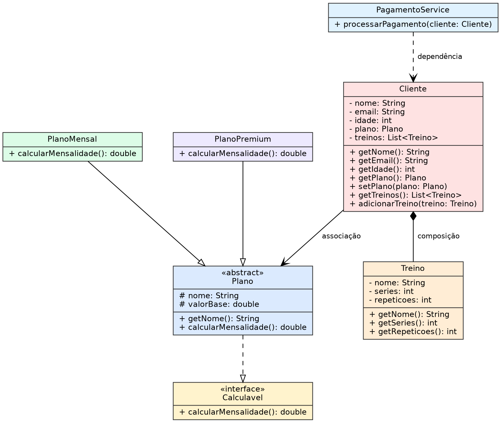

# FitLife

Sistema simples da academia FitLife em Java (Unidade 4 - Atividade Prática)

## Estrutura
- src: classes do sistema (Cliente, Plano, PlanoMensal, PlanoPremium, Treino, PagamentoService, Calculavel, Main)
- test: testes JUnit 5 (FitLifeTest)

## Diagrama de classes

## Conceitos aplicados
- Classes e objetos, encapsulamento (atributos privados, getters e setters)
- Herança e polimorfismo (Plano, PlanoMensal, PlanoPremium)
- Interface (Calculavel) e classe abstrata (Plano)
- Relacionamentos: associação (Cliente e Plano), composição (Cliente e Treino), dependência (PagamentoService e Cliente)
- Tratamento de exceções e validação de dados

## Como executar no VS Code
1. Instale a extensão Extension Pack for Java
2. Abra a pasta fitlife no VS Code (File > Open Folder)
3. Abra Main.java e clique em Run acima do método main
4. Para os testes abra a aba Testing e clique em Enable Java Tests e escolha JUnit
5. Rode os testes pela aba Testing

## Divisão de tarefas
(preencher com o nome de cada integrante do grupo)
